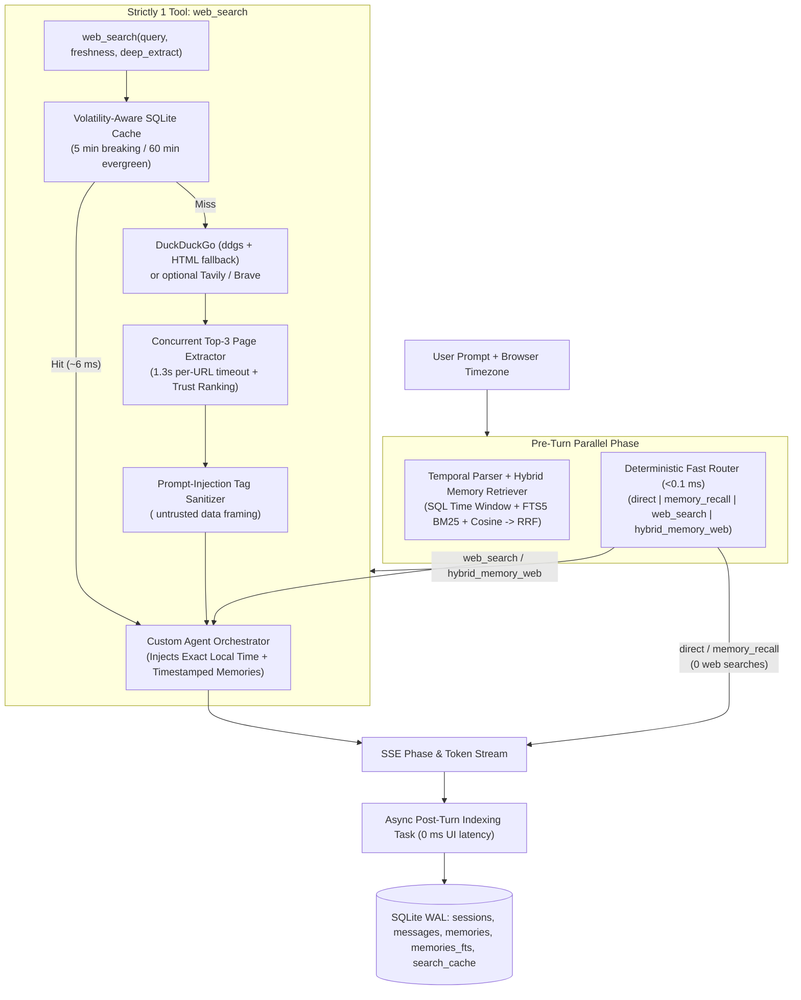

# Kairo — System Design & Architecture

> **Goal:** Build the best possible chat agent using **strictly one tool (`web_search`)** that answers fast, gets facts right with grounded citations, and remembers **what** you asked and **when** across sessions.

---

## 1. Design Principles & Key Tradeoffs

### 1.1 Strict Single-Tool Invariant (`web_search` Only)
Many agents comply with a "one tool" constraint on paper while sneaking in `save_memory`, `search_memory`, or `fetch_url` as additional tool definitions. Kairo enforces a **hard architectural boundary**:

- **LLM Tool Schema (`backend/app/agent/tools.py`)**: `AGENT_TOOLS` contains **exactly 1 tool** (`web_search`). This invariant is asserted in `tests/test_router_and_tools.py` and surfaced live in `/api/health` and the UI Trace Inspector.
- **Why memory stays outside the tool schema**: Memory recall and temporal resolution run **deterministically in the pre-turn orchestrator** (`~5–12 ms`), and memory indexing runs **asynchronously post-turn** (`0 ms` user-facing latency). Putting memory behind a tool call would both violate the 1-tool rule and add an extra 500–2000 ms LLM round-trip on every recall question.
- **Why URL fetching stays inside `web_search`**: Rather than exposing a separate `browse_url` tool, `web_search` optionally performs concurrent page extraction (`deep_extract=true`) on the top ranked results inside a single tool invocation.

### 1.2 Latency-First Custom Runtime (No Framework Overhead)
Instead of heavyweight frameworks (LangChain/LlamaIndex), Kairo uses a lean custom async orchestrator over FastAPI + `httpx`:
- **Zero-LLM Routing (`< 0.1 ms`)**: A deterministic rule classifier (`backend/app/agent/router.py`) separates conversational turns (`direct`), pure history queries (`memory_recall`), live lookups (`web_search`), and memory-augmented web lookups (`hybrid_memory_web`) without burning an extra LLM call or rate-limit quota.
- **Parallel Pre-Turn Context Assembly**: Temporal memory recall and recent session history load concurrently via `asyncio.gather`.
- **SSE Phase + Token Streaming**: The UI receives immediate phase updates (`Checking temporal memory...` -> `Searching web...` -> `Synthesizing...`) before the first token arrives.
- **Bounded Search Budget**: Capped at `MAX_SEARCH_ROUNDS=2` so multi-hop searches cannot stall indefinitely.

### 1.3 Zero-Cost Everything ($0 Stack)
Every layer supports free-tier or local zero-cost operation out of the box:
- **LLM (`backend/app/agent/llm.py`)**: Auto-detects free cloud keys (`groq`, `gemini`, `openrouter`) or falls back seamlessly to local **Ollama** (`mistral:latest`) with zero API keys.
- **Search (`backend/app/search/web_search.py`)**: Uses **DuckDuckGo** (`ddgs` + direct HTML fallback) with zero API keys, with optional Tavily/Brave auto-activation if keys are present.
- **Embeddings (`backend/app/memory/embeddings.py`)**: Uses local Ollama `nomic-embed-text` when reachable, with a `< 0.5 ms` deterministic 256-dim word/char n-gram signed hash projection (`hash-v1`) fallback—zero large downloads and zero API cost.
- **Topic & Summary Extraction (`backend/app/memory/extractor.py`)**: Deterministic local entity/topic extraction avoids extra LLM calls per turn, preserving free-tier RPM limits.

---

## 2. End-to-End Architecture

---

## 3. Hybrid Temporal-Semantic Memory ("What & When")

Standard vector RAG answers *"what topic is similar?"* but fails at *"what did I ask yesterday afternoon?"* or *"when did I first ask about Rust?"*.

### 3.1 Storage Schema (`backend/app/db/sqlite.py`)
SQLite runs in **WAL mode** with four core tables + FTS5 virtual table:
- `sessions (id, title, created_at, updated_at)`
- `messages (id, session_id, role, content, created_at, created_ts, local_date, citations_json, trace_json)`
- `memories (id, session_id, message_id, user_query, assistant_summary, topics_json, embedding_model, embedding_json, created_at, created_ts, local_date)`
- `memories_fts` (`FTS5` virtual table indexing `user_query`, `assistant_summary`, `topics`)
- `search_cache (cache_key, query, freshness, results_json, created_ts, expires_ts)`

### 3.2 Temporal Query Planner (`backend/app/memory/temporal.py`)
Incoming prompts are parsed against the user's actual timezone (`tz_name` / `tz_offset_minutes`):
1. **Explicit & Relative Time Windows**: Resolves `today`, `yesterday`, `this morning/afternoon/evening`, `last night`, `day before yesterday`, `N minutes/hours/days/weeks ago`, `past N days`, weekdays (`last Tuesday`), `Nov 8`, and `YYYY-MM-DD` into exact `[start_ts, end_ts]` UTC epoch bounds.
2. **Chronological Ordering Intent**: Detects `first` / `earliest` (`sort_order = "asc"`) vs `last` / `most recent` (`sort_order = "desc"`).
3. **Topic Isolation (`cleaned_topic_query`)**: Strips meta/time boilerplate (`"When did I first ask about FastAPI?"` -> `"FastAPI"`) so FTS5 and semantic similarity match the topic cleanly.

### 3.3 3-Signal Reciprocal Rank Fusion (RRF) & Negative Abstention
Candidates are scored across three signals:
1. **Time-Window SQL Filter** (`created_ts BETWEEN start_ts AND end_ts`),
2. **FTS5 BM25 Keyword Match** (with query punctuation sanitized so tokens like `C++` never fail FTS5 parsing),
3. **Cosine Vector Similarity**.

**Abstention Guard**: If a user asks a topic-specific memory question without a time constraint (e.g., *"Did I ever ask about quantum computing?"*) and neither FTS5 nor vector similarity meets threshold, Kairo intentionally returns **0 memories** rather than polluting the context with unrelated turns—preventing false-positive memory hallucinations.

---

## 4. Accuracy, Grounding & Security Controls

1. **Beyond Snippets**: `web_search` concurrently fetches and parses `<article>` / `<main>` paragraphs and `<meta>` publish dates from the top 3 results (`backend/app/search/extractor.py`), giving the LLM rich factual evidence rather than truncated search snippets.
2. **Domain Authority + Recency Ranking**: Authoritative domains (`.gov`, `.edu`, official docs, major news/reference sites) receive a deterministic trust boost over random SEO pages.
3. **Strict Inline Citations (`[1]`, `[2]`)**: Results are wrapped in numbered `<source id="..." domain="..." url="..." published="...">` tags and re-indexed globally across search rounds so inline `[n]` pills map deterministically to clickable source cards.
4. **Prompt Injection Defense**: Control characters and spoofing tags (`</source>`, `<system>`, `<instructions>`) are stripped from scraped web pages before reaching the prompt, and the system prompt explicitly marks search results as untrusted external data.
5. **Small-Model Tool-Call Fallback (`backend/app/agent/llm.py`)**: A 12-character lookahead buffer during streaming incurs zero lag on normal prose while cleanly catching raw JSON tool calls emitted inside `content` by smaller open-weight models.

---

## 5. Observability & Recruiter Evaluation Features

- **Live Agent Trace Drawer**: Every assistant turn carries a structured `trace` object (route decision, timing bars for Memory Recall / Router / Search / TTFT / Total, recalled memories + RRF scores, `web_search` queries, cache hit status, and tool schema count).
- **Memory Timeline Sidebar**: Chronological, FTS5-searchable view of every user question grouped by local date with jump-to-session navigation.
- **Automated Evaluation Suite (`evals/run_evals.py`)**: Reproducible benchmark measuring temporal recall precision, router accuracy, strict 1-tool compliance, and live/cached search latency.

---

## 6. Measured Evaluation Results & Failure Modes

Results observed from running `.venv\Scripts\pytest.exe -v` and `.venv\Scripts\python.exe evals\run_evals.py --live`:

| Benchmark Suite | Score / Result | Measured Latency | Notes |
| --- | --- | --- | --- |
| Unit & API Tests (`pytest`) | **12 / 12 passed** | 4.38s total | Covers temporal parser, FTS5/RRF memory, 1-tool invariant, cache, SSE API |
| Temporal Memory Eval (5 cases) | **5 / 5 (100.0%)** | **p50: 5.47 ms**, p95: 10.54 ms | Includes negative abstention (`0` false positives) & earliest-topic ordering |
| Router & Tool Invariant Eval | **9 / 9 (100.0%)** | **p50: 0.02 ms** | `single_tool_invariant: true` (`AGENT_TOOLS == ["web_search"]`) |
| Live DuckDuckGo Search (Uncached) | 5 sources, 3 page excerpts | **2,969.75 ms** | Zero-key DDG HTML search + concurrent top-3 article extraction |
| SQLite Search Cache Hit | Verified hit | **9.54 ms** | Volatility-aware TTL (5m breaking / 60m evergreen) |

### Known Limitations & Next Improvements
1. **DuckDuckGo Rate Limiting**: Zero-key DuckDuckGo queries can occasionally encounter transient rate-limits or slower responses compared to dedicated search APIs; `WebSearchService` mitigates this via automatic `ddgs` -> DuckDuckGo HTML fallback + SQLite TTL caching, and supports 1-env-var upgrade to Tavily or Brave.
2. **Local 7B Tool-Calling Latency**: Local Ollama `mistral:latest` runs at $0 cost offline but takes longer per token than cloud GPUs; setting a free Groq or Gemini key switches inference to sub-second latency with zero code changes.
3. **Single-User Local Persistence**: SQLite is scoped to a single workspace/user instance; multi-tenant deployment would partition `sessions` and `memories` by `user_id` and swap SQLite for Postgres + `pgvector`.
